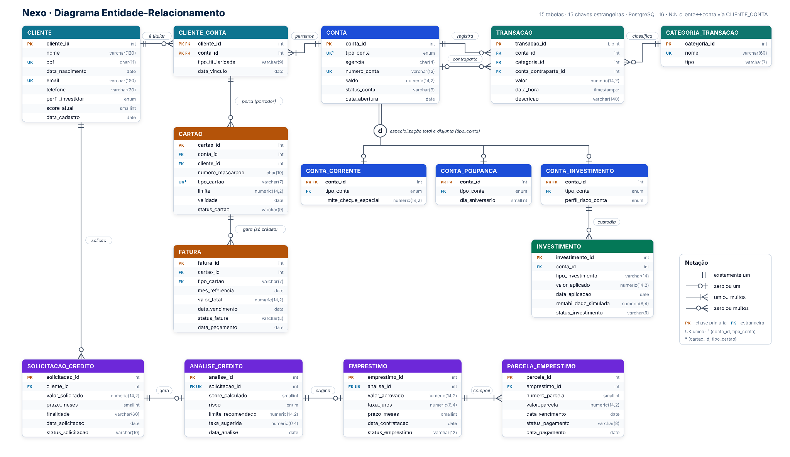

<div align="center">

# Nexo

**Administração e segurança do banco de dados de uma fintech**

Projeto A3 · Banco de Dados · Universidade São Judas Tadeu · 2026


[Relatório final](docs/relatorio-final-nexo.pdf) · [Apresentação](apresentacao/apresentacao-nexo.pdf) · [DER](modelagem/der-nexo.png) · [Scripts SQL](sql/)

</div>

---

## Sobre o projeto

A **Nexo** é um protótipo acadêmico de plataforma de crédito e saúde financeira. A proposta parte de um problema comum: muitas pessoas têm score e limite, mas não sabem por que foram aprovadas ou recusadas, nem quanto conseguem pagar. A Nexo reúne dados financeiros (saldo, transações, cartões e investimentos) para oferecer score, limite recomendado, simulação de empréstimo e, principalmente, a **explicação da decisão de crédito**.

O trabalho foi desenvolvido no domínio **Banco Digital / Fintech** proposto no enunciado da A3 e concentra-se no banco de dados relacional que sustenta a plataforma.

> *"Quanto crédito eu realmente consigo assumir com segurança — e por quê?"*

### Objetivo

Documentar e avaliar a estrutura de banco de dados da Nexo, demonstrando mecanismos de administração, integridade, segurança e desempenho adequados ao cenário acadêmico de uma fintech.

### Objetivos específicos

- Modelar as entidades e os relacionamentos da plataforma.
- Implementar a estrutura no PostgreSQL 16 e carregar dados sintéticos.
- Aplicar restrições de integridade e executar consultas analíticas.
- Testar transações e concorrência.
- Avaliar índices com `EXPLAIN ANALYZE`.
- Realizar backup e restauração.
- Aplicar controle de acesso por papéis e privilégios.
- Relacionar as medidas adotadas aos princípios da LGPD.

### Escopo

| Dentro do escopo | Fora do escopo |
|---|---|
| 15 tabelas, consultas, transações, concorrência, índices, backup e restauração, controle de acesso e medidas de LGPD | Aplicação web ou móvel completa, integração real com Pix ou bureaus de crédito, replicação, alta disponibilidade, dinheiro real e IA complexa |

---

## Modelagem

O modelo final possui **15 tabelas**: 12 entidades e 3 subtipos de conta, organizadas em cinco áreas.

| Área | Tabelas |
|---|---|
| Clientes e contas | `cliente`, `conta`, `cliente_conta`, `conta_corrente`, `conta_poupanca`, `conta_investimento` |
| Movimentação | `transacao`, `categoria_transacao` |
| Cartões | `cartao`, `fatura` |
| Investimentos | `investimento` |
| Crédito | `solicitacao_credito` → `analise_credito` → `emprestimo` → `parcela_emprestimo` |

**Destaques do modelo**

- **N:N real:** um cliente pode ter várias contas e uma conta pode ter vários titulares (conta conjunta), resolvido pela tabela associativa `cliente_conta`.
- **Especialização total e disjunta:** `conta` é o supertipo de `conta_corrente`, `conta_poupanca` e `conta_investimento`.
- **Fluxo de crédito em etapas:** solicitação, análise, empréstimo e parcelas, pois nem toda solicitação resulta em empréstimo.

<p align="center">
  
  <br><sub>Diagrama entidade-relacionamento do modelo final (Figura 1 do relatório)</sub>
</p>

O DER do modelo inicial do grupo, a partir do qual o modelo final evoluiu, está em [`modelagem/versao-inicial/`](modelagem/versao-inicial/der-inicial-mermaid.jpg).

---

## Desenvolvimento e resultados

Os números abaixo foram extraídos do [relatório final](docs/relatorio-final-nexo.pdf) e se referem à rodada oficial de testes em PostgreSQL 16.15.

**Base sintética carregada:** 309 clientes, 376 contas, 120.359 transações, 1.207 solicitações de crédito, 1.006 análises, 809 empréstimos e 17.848 parcelas, entre outros registros.

| Tema | Resultado |
|---|---|
| Integridade | 29 comandos inválidos recusados pelo banco, cada um com o SQLSTATE esperado |
| Índices | Ganhos de 3,4× a 42,7× nas consultas críticas medidas com `EXPLAIN ANALYZE` |
| Concorrência | Duas transferências simultâneas na mesma conta: com `SELECT ... FOR UPDATE`, a segunda é recusada e o saldo final fica correto (R$ 200,00) |
| Backup e restauração | `pg_dump` em formato custom com SHA-256; restauração em banco independente com 15/15 tabelas idênticas |
| Controle de acesso | Papéis `nexo_app` e `nexo_analista` com menor privilégio e `REVOKE` de `PUBLIC` |
| LGPD | Dados sintéticos, cartão mascarado, visões mascaradas e função de minimização de dados |
| Bateria de testes | 8 grupos (T1 a T8), **76 verificações aprovadas e nenhuma falha** |

---

## Organização do repositório

```text
nexo-fintech-a3/
├── README.md
├── docs/
│   ├── relatorio-final-nexo.pdf       # relatório técnico (ABNT)
│   ├── relatorio-final-nexo.docx      # versão editável do relatório
│   └── log-de-contribuicoes.md        # registro de quem fez o quê, por marco
├── apresentacao/
│   ├── apresentacao-nexo.pdf          # slides, incluindo Q1–Q13
│   └── apresentacao-nexo.pptx         # versão editável, com navegação entre slides
├── modelagem/
│   ├── der-nexo.png                   # DER do modelo final
│   └── versao-inicial/
│       └── der-inicial-mermaid.jpg    # DER do modelo inicial do grupo
└── sql/
    ├── 01_ddl_modelo_inicial.sql      # DDL do modelo inicial
    └── 02_consultas_insights.sql      # 13 consultas analíticas (Q1–Q13)
```

## Entregáveis

| Entregável | Arquivo |
|---|---|
| DER | [`modelagem/der-nexo.png`](modelagem/der-nexo.png) |
| Relatório final | [`docs/relatorio-final-nexo.pdf`](docs/relatorio-final-nexo.pdf) |
| Apresentação | [`apresentacao/apresentacao-nexo.pdf`](apresentacao/apresentacao-nexo.pdf) |
| Log de contribuições | [`docs/log-de-contribuicoes.md`](docs/log-de-contribuicoes.md) |
| DDL do modelo inicial | [`sql/01_ddl_modelo_inicial.sql`](sql/01_ddl_modelo_inicial.sql) |
| Consultas Q1–Q13 | [`sql/02_consultas_insights.sql`](sql/02_consultas_insights.sql) |

---

## Como executar os scripts

Pré-requisito: PostgreSQL 16 instalado e acessível pelo `psql`. Os dois scripts rodam juntos, sobre o modelo inicial.

```bash
createdb nexo
psql -d nexo -v ON_ERROR_STOP=1 -1 -f sql/01_ddl_modelo_inicial.sql
psql -d nexo -f sql/02_consultas_insights.sql
```

---

## Segurança e LGPD

O projeto utiliza **somente dados fictícios**. Nenhum dado pessoal real foi tratado. As medidas adotadas seguem os princípios de necessidade, segurança, prevenção e transparência da LGPD (Lei nº 13.709/2018), sem pretensão de conformidade jurídica completa por se tratar de um protótipo acadêmico.

## Uso de inteligência artificial

O uso de IA generativa no projeto está declarado na nota de rodapé 1 do [relatório final](docs/relatorio-final-nexo.pdf), como exige o enunciado da A3.

---

## Equipe

| Integrante |
|---|
| Cauã Porto Bello |
| Douglas Pozenato Junior |
| Henryco Meneghetti de Queiróz |
| Lucas da Silva Cavalcante |
| Matheus Fioruci |
| Yasmin Morais Silva |

**Instituição:** Universidade São Judas Tadeu (USJT)
**Cursos:** Ciência da Computação e Análise e Desenvolvimento de Sistemas
**Unidade curricular:** Banco de Dados
**Professores:** Wilson Andrade e Edcleisson Zanardi

---

## Considerações finais

O desenvolvimento da Nexo mostrou que administrar um banco de dados financeiro exige mais do que criar tabelas: a estrutura precisa incorporar integridade, controle de concorrência, índices, recuperação, controle de acesso e proteção de dados. Como evolução, o relatório aponta auditoria mais detalhada, histórico explícito de score, inclusão de renda mensal no modelo e recuperação a um ponto no tempo.

## Referências

- BRASIL. Lei nº 9.613, de 3 de março de 1998. Disponível em: <https://www.planalto.gov.br/ccivil_03/leis/l9613.htm>.
- BRASIL. Lei Complementar nº 105, de 10 de janeiro de 2001. Disponível em: <https://www.planalto.gov.br/ccivil_03/leis/lcp/lcp105.htm>.
- BRASIL. Lei nº 13.709, de 14 de agosto de 2018 (LGPD). Disponível em: <https://www.planalto.gov.br/ccivil_03/_ato2015-2018/2018/lei/l13709.htm>.
- POSTGRESQL GLOBAL DEVELOPMENT GROUP. *PostgreSQL 16 documentation*. Disponível em: <https://www.postgresql.org/docs/16/>.

<div align="center">
<sub>Projeto acadêmico · Todos os valores e dados são fictícios.</sub>
</div>
